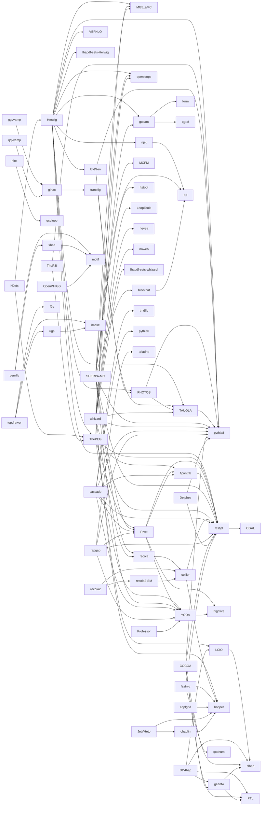

# HEPrpms package dependencies

This file records the dependencies **between packages that are packaged in this repository**.
It was derived from the `BuildRequires:` / `Requires:` lines of the newest spec file of every package
(newest version directory, as of November 2026). Dependencies on packages that come from the distribution
(compilers, python, cmake, TeX, `root`, `lhapdf`, `HepMC`, `HepMC3`, `hdf5`, `boost`, `gsl`, ...) are
listed separately at the end and are not part of the graph.

When a package is bumped, re-check its `BuildRequires:`/`Requires:` and update this file if the
repository-internal dependencies changed.

## Conventions

- **B** = needed at build time (`BuildRequires`), **R** = needed at run time (`Requires`).
  An entry without a marker is both.
- A dependency on `X` includes its `-devel`, `-data`, `python3-X` etc. subpackages where relevant.
- Spec files contain Fedora/EPEL and openSUSE branches. The names differ between them, but they refer to the
  same repository package or distribution package:

  | openSUSE name        | Fedora/EPEL name |
  |----------------------|------------------|
  | `libpythia8`, `pythia-devel`, `pythia-doc` | `pythia8`, `pythia8-devel` |
  | `libHepMC4`, `HepMC2-devel`   | `HepMC`, `HepMC-devel` |
  | `libHepMC3-4`        | `HepMC3` |
  | `libLHAPDF`, `LHAPDF-devel`   | `lhapdf`, `lhapdf-devel` |
  | `libqd0`             | `qd` |
  | `root6`, `root6-libs`, `root6-devel` | `root`, `root-*` |
  | `cgal-devel`         | `CGAL-devel` |

- `HEPrpms` is a meta package that `Requires:` pinned versions of nearly every other package. It is not part of the
  graph below (see [The HEPrpms meta package](#the-heprpms-meta-package)).
- There are no dependency cycles.

## Direct dependencies per package

Only repository-internal dependencies are listed. Packages not listed here have no dependency on other
packages of this repository (see [Leaf packages](#leaf-packages-no-repository-dependencies)).

| Package | Depends on |
|---------|------------|
| applgrid | hoppet |
| blackhat | qd |
| cascade | fastjet, fjcontrib (B), pythia8, pythia6 (R), Rivet, tmdlib, YODA |
| cernlib | motif, xbae |
| chaplin | hoppet (B) |
| COCOA | clhep, fastjet, geant4, pythia8, PTL (all B) |
| collier | fastjet, hoppet |
| DD4hep | clhep, geant4, LCIO, PTL |
| Delphes | fastjet (B), pythia8 (B) |
| EvtGen | PHOTOS, pythia8, TAUOLA |
| fastjet | CGAL |
| fastnlo | fastjet, qcdnum, hoppet (B) |
| fjcontrib | fastjet |
| geant4 | clhep (B), PTL (B) |
| ggvvamp | ginac |
| ginac | transfig (B) |
| gosam | form (R), qgraf (R) |
| Herwig | ThePEG, MG5_aMC, EvtGen, fastjet, gosam, njet, openloops, pythia8, VBFNLO, lhapdf-sets-Herwig; PHOTOS (B), TAUOLA (B) |
| HJets | Herwig (B), ThePEG (B) |
| JetVHeto | chaplin, hoppet |
| LCIO | clhep (B) |
| njet | qd (B) |
| nlox | qcdloop (B) |
| OpenPHIGS | motif |
| PHOTOS | pythia8, TAUOLA |
| Professor | YODA |
| qqvvamp | ginac |
| rapgap | ariadne (R), fastjet, pythia8 (B), Rivet, YODA |
| recola | collier |
| recola2 | collier, recola2-SM |
| recola2-SM | collier |
| Rivet | fastjet, fjcontrib, highfive, YODA |
| SHERPA-MC | blackhat, fastjet, MCFM, MG5_aMC, openloops, pythia8, qd, recola, Rivet, YODA; hztool (R) |
| TAUOLA | pythia8 |
| TheP8I | pythia8, ThePEG |
| ThePEG | fastjet, fjcontrib, MG5_aMC, Rivet, YODA |
| topdrawer | ugs, f2c (B), imake (B) |
| ugs | imake (B) |
| whizard | fastjet, gosam, hoppet, LCIO, LoopTools, openloops, pythia8, recola, TAUOLA; hevea (B), noweb (B), lhapdf-sets-whizard (B) |
| xbae | motif |
| YODA | highfive (B) |

Notes:

- `ginac` is also provided by some distributions; `ggvvamp`/`qqvvamp` use it from whichever source is available.
- `collier` lists `fastjet` and `hoppet` in the spec even though they are not obviously needed by the library itself.
- `lhapdf-sets-Herwig` and `lhapdf-sets-whizard` need only the distribution `lhapdf` (to download the PDF sets).
- `OpenPHIGS`, like `cernlib` and `xbae`, requires Motif by its distribution name (`motif-devel`, or `openmotif-devel` on EPEL 8/9), which the repository's `motif` package provides.
- `iminuit`, `python-uproot4`, `python-mpmath` and `sympy` are Python packages; they have no repository dependencies.

## Leaf packages (no repository dependencies)

apfel, ariadne, binder, CGAL, clhep, cuba, f2c, f90cache, FeynHiggs, form, golem95, gosam-contrib, HepPDT, hevea,
highfive, hoppet, hztool, imake, iminuit, lhapdf-sets-Herwig\*, lhapdf-sets-whizard\*, LoopTools, MC-TESTER, MCFM,
MG5_aMC, motif, nlojet++, noweb, openloops, PTL, pythia6, pythia8, python-mpmath, python-uproot4, qcdloop, qcdnum, qd,
qgraf, sympy, tmdlib, transfig, VBFNLO

\* these need only the distribution `lhapdf`.

## Build order

Packages in a layer depend only on packages in lower layers, so a layer can be built (e.g. on COPR) once all
previous layers are built.

| Layer | Packages |
|-------|----------|
| 0 | apfel, ariadne, binder, CGAL, clhep, cuba, f2c, f90cache, FeynHiggs, form, golem95, gosam-contrib, HepPDT, hevea, highfive, hoppet, hztool, imake, iminuit, lhapdf-sets-Herwig, lhapdf-sets-whizard, LoopTools, MC-TESTER, MCFM, MG5_aMC, motif, nlojet++, noweb, openloops, PTL, pythia6, pythia8, python-mpmath, python-uproot4, qcdloop, qcdnum, qd, qgraf, sympy, tmdlib, transfig, VBFNLO |
| 1 | applgrid, blackhat, chaplin, fastjet, geant4, ginac, gosam, LCIO, njet, nlox, OpenPHIGS, TAUOLA, ugs, xbae, YODA |
| 2 | cernlib, COCOA, collier, DD4hep, Delphes, fastnlo, fjcontrib, ggvvamp, JetVHeto, PHOTOS, Professor, qqvvamp, topdrawer |
| 3 | EvtGen, recola, recola2-SM, Rivet |
| 4 | cascade, rapgap, recola2, SHERPA-MC, ThePEG, whizard |
| 5 | Herwig, TheP8I |
| 6 | HJets |

## Reverse dependencies (what must be rebuilt when a package changes)

Direct dependents only; follow the chain for transitive ones.

| Package | Used by |
|---------|---------|
| ariadne | rapgap |
| blackhat | SHERPA-MC |
| CGAL | fastjet |
| chaplin | JetVHeto |
| clhep | COCOA, DD4hep, geant4, LCIO |
| collier | recola, recola2, recola2-SM |
| EvtGen | Herwig |
| f2c | topdrawer |
| fastjet | cascade, COCOA, collier, Delphes, fastnlo, fjcontrib, Herwig, rapgap, Rivet, SHERPA-MC, ThePEG, whizard |
| fjcontrib | cascade, Rivet, ThePEG |
| form | gosam |
| geant4 | COCOA, DD4hep |
| ginac | ggvvamp, qqvvamp |
| gosam | Herwig, whizard |
| Herwig | HJets |
| hevea | whizard |
| highfive | Rivet, YODA |
| hoppet | applgrid, chaplin, collier, fastnlo, JetVHeto, whizard |
| hztool | SHERPA-MC |
| imake | topdrawer, ugs |
| LCIO | DD4hep, whizard |
| lhapdf-sets-Herwig | Herwig |
| lhapdf-sets-whizard | whizard |
| LoopTools | whizard |
| MCFM | SHERPA-MC |
| MG5_aMC | Herwig, SHERPA-MC, ThePEG |
| motif | cernlib, OpenPHIGS, xbae |
| njet | Herwig |
| noweb | whizard |
| openloops | Herwig, SHERPA-MC, whizard |
| PHOTOS | EvtGen, Herwig |
| PTL | COCOA, DD4hep, geant4 |
| pythia6 | cascade |
| pythia8 | cascade, COCOA, Delphes, EvtGen, Herwig, PHOTOS, rapgap, SHERPA-MC, TAUOLA, TheP8I, whizard |
| qcdloop | nlox |
| qcdnum | fastnlo |
| qd | blackhat, njet, SHERPA-MC |
| qgraf | gosam |
| recola | SHERPA-MC, whizard |
| recola2-SM | recola2 |
| Rivet | cascade, rapgap, SHERPA-MC, ThePEG |
| TAUOLA | EvtGen, Herwig, PHOTOS, whizard |
| ThePEG | Herwig, HJets, TheP8I |
| tmdlib | cascade |
| transfig | ginac |
| ugs | topdrawer |
| VBFNLO | Herwig |
| xbae | cernlib |
| YODA | cascade, Professor, rapgap, Rivet, SHERPA-MC, ThePEG |

## Dependency graph

Arrows point from a package to the package it depends on. Only packages with at least one repository dependency
are shown.

## The HEPrpms meta package

`HEPrpms/<version>/HEPrpms.spec` has no sources; it `Requires:` an exact version (`== x.y.z`) of nearly every
package and subpackage in this repository, so that installing `HEPrpms` pulls in the whole collection. The pinned
versions are updated by hand and may lag behind the newest version directories. Any new package that should be part
of the collection must be added there as well.

## Dependencies on distribution packages

Not packaged here; they come from Fedora/EPEL/openSUSE.

| Distribution package | Used by |
|----------------------|---------|
| `root` (`root-core`, `root-tree-ntuple-utils`, ...) | applgrid, cascade, COCOA, DD4hep, Delphes, EvtGen, fastnlo, LCIO, MC-TESTER, Professor, SHERPA-MC, tmdlib, VBFNLO, whizard |
| `lhapdf` | apfel, cascade, fastnlo, Herwig, JetVHeto, lhapdf-sets-\*, MCFM, pythia8, TAUOLA, TheP8I, ThePEG, tmdlib, VBFNLO, whizard |
| `HepMC` (HepMC2) | cascade, COCOA, Delphes, EvtGen, MC-TESTER, PHOTOS, rapgap, TAUOLA, VBFNLO |
| `HepMC3` (`-search`, `-rootIO`) | cascade, EvtGen, MC-TESTER, PHOTOS, rapgap, Rivet, SHERPA-MC, TAUOLA, ThePEG, whizard |
| `hdf5` | highfive, Rivet, whizard |
| `boost` | DD4hep, Herwig, HJets, ThePEG, tmdlib, whizard |
| `gsl` | cascade, HJets, Herwig, Rivet, TheP8I, ThePEG, tmdlib, VBFNLO |
| `tbb` | DD4hep, PTL |
| `xerces-c`, `expat` | COCOA, DD4hep, geant4 |
| `cln` | ginac, ggvvamp, qqvvamp |
| `yaml-cpp` | fastnlo, JetVHeto, YODA |
| `openmpi` | SHERPA-MC, whizard |
| `ocaml` | hevea, whizard |
| `clang`, `llvm`, `pybind11` | binder, iminuit |
| `eigen3`, `qt5` | CGAL, Professor |
| TeX Live / `ghostscript` / `doxygen` | documentation builds of most packages |
| Python (`python3-devel`, `Cython`, `numpy`, `setuptools`, `matplotlib`) | Python bindings of apfel, fastjet, fastnlo, LCIO, Professor, Rivet, whizard, YODA, MG5_aMC, openloops, njet |
| X11 / `libX*` | cernlib, OpenPHIGS, topdrawer, ugs, xbae, motif, imake |
| `glew`, `gl2ps`, `mesa-libGLU` (`Mesa-libGLU` on openSUSE), `libpng` | OpenPHIGS |
